# CART 253 Prototyping

Agustin Maximo Lee

## Description

> This website shows off the work I've made throughout CART 253. Each project is in its own folder with a different idea, technique, or piece of creative code.

## Useful Links

> - [Course Website](https://agusmaxlee.github.io/CART253-Web_Project/)
> - [Reflective Journal](./journal.md)

## Challenges

### Hello, World!

#### Version Control Workflow

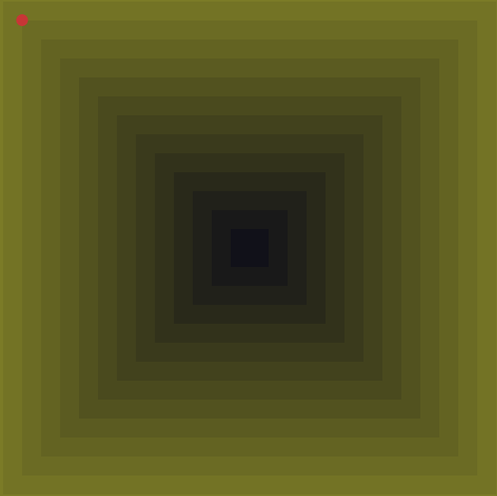

[View running prototype](./topics/version-control/version-control-workflow/) | [View code](./topics/version-control/version-control-workflow/)

### Instructions

#### Minion

[View running prototype](https://agusmaxlee.github.io/CART253-Web_Project/topics/instructions-challenge/) | [View code](./topics/instructions-challenge/)

### Variables

#### Mr. Furious

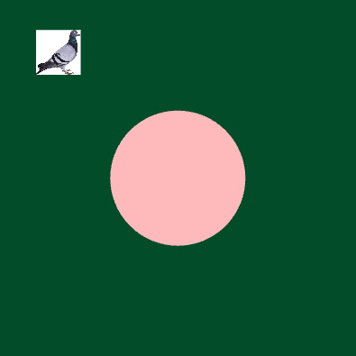

[View running prototype](https://agusmaxlee.github.io/CART253-Web_Project/topics/variables-challenge/) | [View code](./topics/variables-challenge/)

## Prototyping

> See the [journal entry](./journal.md) for this assignment.

### Instructions

#### Rocket Launch

[View running prototype](https://agusmaxlee.github.io/CART253-Web_Project/topics/instructions-prototype/rocket/) | [View code](./topics/instructions-prototype/rocket/)

#### Robot Head

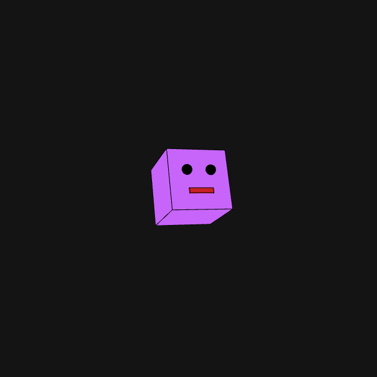

[View running prototype](https://agusmaxlee.github.io/CART253-Web_Project/topics/instructions-prototype/robot/) | [View code](./topics/instructions-prototype/robot/)

#### Shape Generator

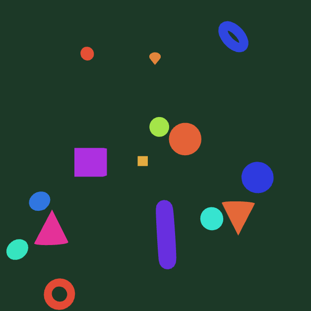

[View running prototype](https://agusmaxlee.github.io/CART253-Web_Project/topics/instructions-prototype/shape-generator/) | [View code](./topics/instructions-prototype/shape-generator/)

### Variables

#### Mr. Impossible

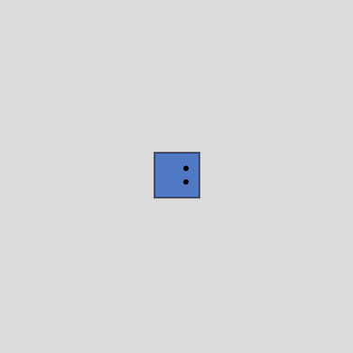

[View running prototype](https://agusmaxlee.github.io/CART253-Web_Project/topics/variables-prototype/mr-impossible/) | [View code](./topics/variables-prototype/mr-impossible/)

#### Swinging Door

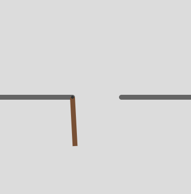

[View running prototype](https://agusmaxlee.github.io/CART253-Web_Project/topics/variables-prototype/swinging-door/) | [View code](./topics/variables-prototype/swinging-door/)

#### Mr. Impossible's House

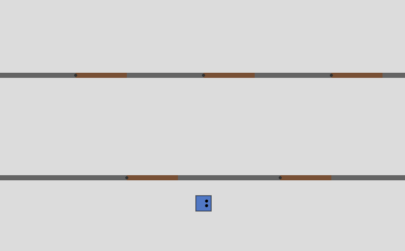

[View running prototype](https://agusmaxlee.github.io/CART253-Web_Project/topics/variables-prototype/mr-impossibles-house/) | [View code](./topics/variables-prototype/mr-impossibles-house/)

### Conditionals

#### Mystery Gift

[View running prototype](https://agusmaxlee.github.io/CART253-Web_Project/topics/conditionals-prototype/mystery-gift/) | [View code](./topics/conditionals-prototype/mystery-gift/)

#### No-No Box

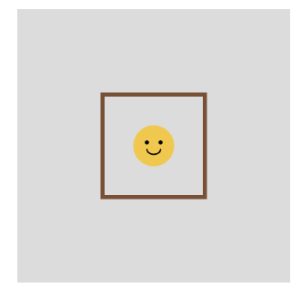

[View running prototype](https://agusmaxlee.github.io/CART253-Web_Project/topics/conditionals-prototype/no-no-box/) | [View code](./topics/conditionals-prototype/no-no-box/)

#### Four Moods

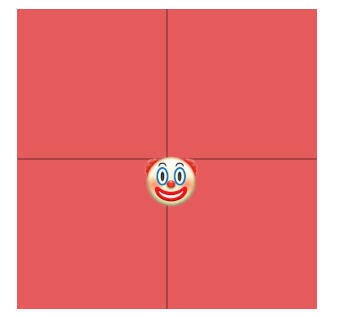

[View running prototype](https://agusmaxlee.github.io/CART253-Web_Project/topics/conditionals-prototype/four-moods/) | [View code](./topics/conditionals-prototype/four-moods/)

### Events

#### Tilt Simulator

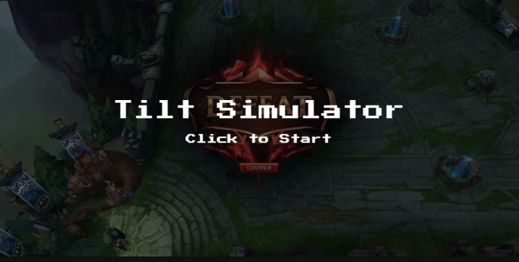

[View running prototype](https://agusmaxlee.github.io/CART253-Web_Project/topics/events-prototype/tilt-simulator/) | [View code](./topics/events-prototype/tilt-simulator/)

### Functions

#### Tilt Simulator (refactored)

> Reused this week's Tilt Simulator and refactored repeated code into functions (lane creation, the lane loops, collision checks).

[View running prototype](https://agusmaxlee.github.io/CART253-Web_Project/topics/events-prototype/tilt-simulator/) | [View code](./topics/events-prototype/tilt-simulator/)

#### Mall Janitor Simulator

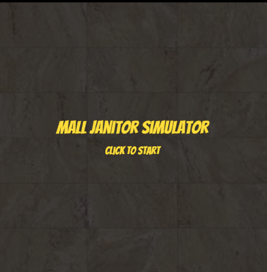

[View running prototype](https://agusmaxlee.github.io/CART253-Web_Project/topics/functions-prototype/mall-janitor-simulator/) | [View code](./topics/functions-prototype/mall-janitor-simulator/)

#### Rock Paper Scissors

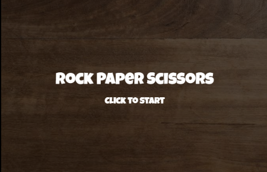

[View running prototype](https://agusmaxlee.github.io/CART253-Web_Project/topics/functions-prototype/rock-paper-scissors/) | [View code](./topics/functions-prototype/rock-paper-scissors/)
