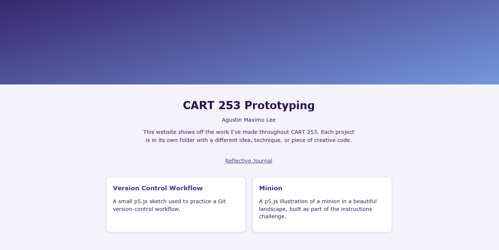
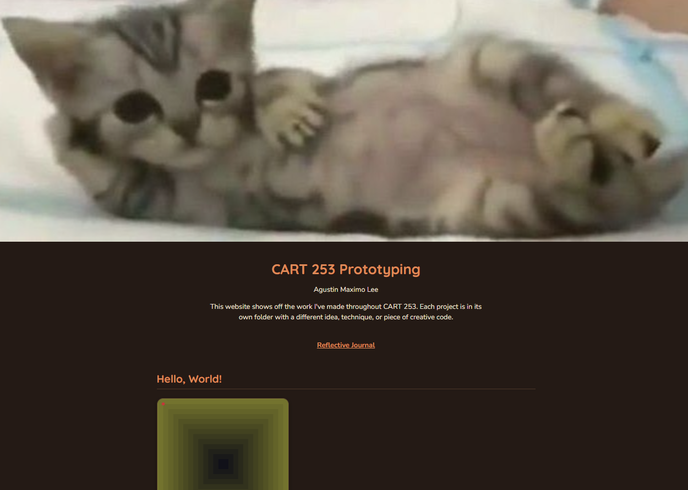
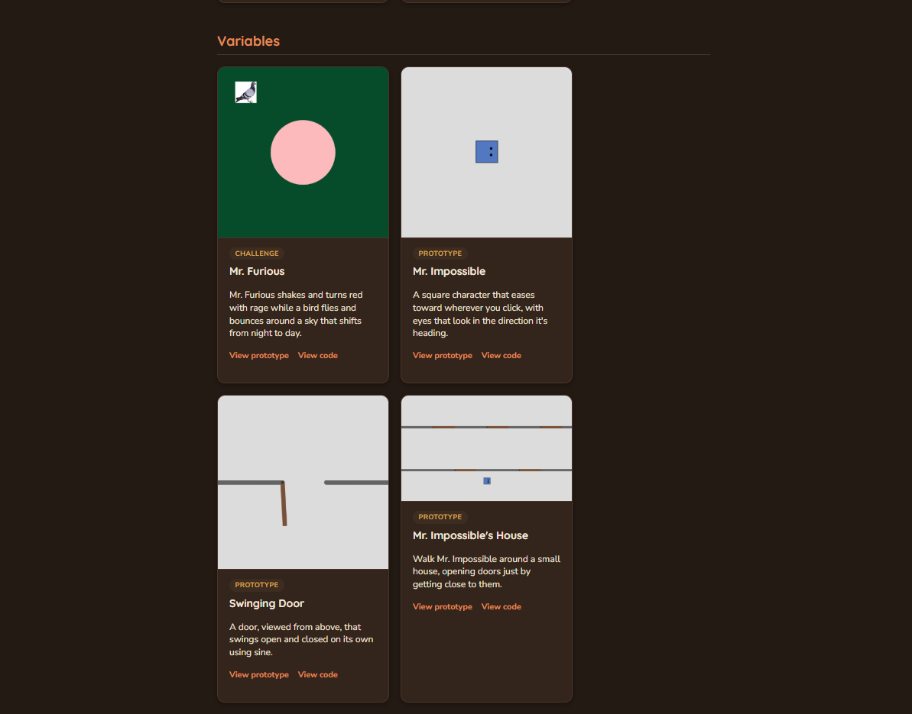
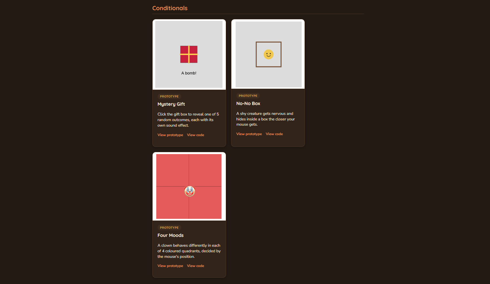
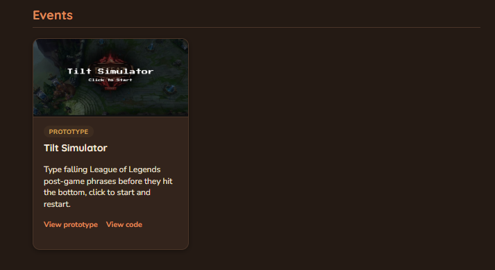
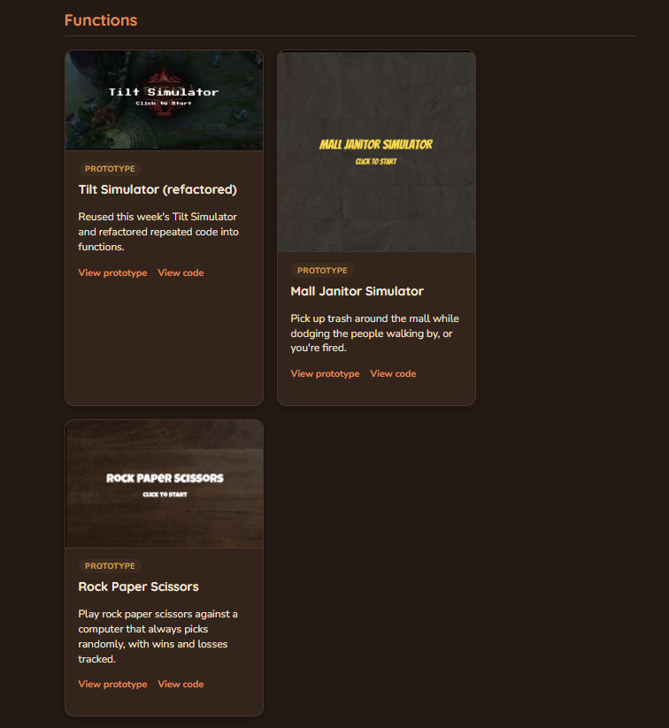

# Reflective Journal

## September 17, 2026

> I was surprised about using markdown. Honestly, I never realized what it was until recently. At first I thought it was some sort of terminal like git bash, later to find out its just a text based syntax like html. I quickly learned how it worked and how to get around with some of the syntax it has since its very similar (and simpler) than html. Embarrasing to admit that i never realized .md files meant markdown files.

> Github in the other hand was something I am familiar with: version control, commits, pushes, etc. The only thing im still unfamiliar with are branches and when many people work in a single repo and cause many conflicts... To my surprise, I really enjoyed Github Desktop by its simple UI and straightforward actions you can do; no need for git commands or git bash at all. (I was taught that using github desktop was bad).

> I really hope I can master markdown and p5 for many future projects! 

## September 24, 2026

> Working on these three prototypes honestly reminded me why I liked programming in the first place. Going back to the absolute basics was way more fun than I expected. I forgot how satisfying it is to build something from literally nothing, just messing around with shapes, colors, and variables until it starts looking like something.

> What surprised me the most is how much I ended up playing on my own. I only needed a couple of shapes, but I got so into it that I HAD TO put in arrays, different variables, random shape types, spinning/moving booleans, HSB color mode... way more than I really should have for something this simple. I just really started to think: "How can I make this work?, Whats a better way to do it?". Looking back, that's honestly a good sign (right?). 

> The hardest part wasnt really the p5 functions themselves, it was re-learning how to think through a problem step by step instead of jumping straight to an answer. Its been a really long time since I built something from scratch like this. Embarrassing to admit, but Ive gotten so used to already having AI and examples to start from and to help me debug. Just starting with a "blank" file felt... kinda scary at first.

## October 1, 2026

> After finishing the Robot Head prototype last week, I wanted to push further and make something more interactive, not just something to look at. So for this week I decided to combine the three required prototypes (well, really two of them) into one small game instead of three separate little sketches: Mr. Impossible walking around a tiny house, opening doors just by getting close to them.

> What surprised me the most was how hard something as "simple" as collision feels once you have to build it yourself. I'm used to game engines that already handle walls, doors, and physics for you... so you just drag things into place and it works. Here, just making sure a square character couldn't walk through a wall unless there was an open doorway took way more thinking than I expected.

> I originally wanted to add collectables and sound effects to make it feel more like an actual mini-game, but I ended up getting stuck on the most basic mechanic of all: walls.

> Still, I don't see it as wasted time. There is clearly a lot more to experiment with here, and I'd like to come back to this house later and actually add the collectables and sounds I had in mind.

## October 8, 2026

> This week's prototypes mostly came from stuff I saw in class like a few examples we looked at made it pretty obvious where the conditionals were, so starting was honestly way easier than other weeks.

> What surprised me the most is how dumb some of my mistakes were, and how simple the fix usually turned out to be once I actually found it like just moving a line up or changing the name of a function... Feels like every time I'm stuck on something for way too long, the real problem ends up being one tiny thing.

> Conditionals themselves are a pretty simple idea once it clicks, so I wanted the if/else logic to be easy to spot in the code for each one. Part of it is also that I just didn't have a ton of time to dig into these properly this week, so keeping them small and simple was kind of the only realistic option too.

> I think thats also what I hope someone else gets from looking at these: a clear "this condition leads to this outcome," without having to dig through a bunch of other stuff first. Mystery Gift, No-No Box, and Four Moods each show a different flavor of if/else, but all stay easy to follow.

## October 22, 2026

> Gonna be honest in this one: I didnt make three prototypes this week, just one. I personally didnt have the time to build three separate things, so instead I put everything into making one really polished prototype instead.

> For like the last week ive been wanting to make a Type Mania clone (one of those typing games where words fall and you have to type them before they hit the ground). I used to play something like that a while back and I genuinely cant find it anywhere online anymore, so I figured Id just build my own version instead of hunting for it.

> What surprised me is that the thing kind of built itself into something different than what I planned. I started with a generic word list, but once the whole game was working I swapped it for League of Legends post-game slang instead, just for fun, and now its basically a "tilt simulator" more than a typing game. Funny how that happened completely by accident.

> The events stuff (mousePressed, keyTyped) ended up being more intuitive than I expected, way more than variables or conditionals were. It just makes sense: something happens, code runs, done.

> The part that actually took me a while to wrap my head around was the typing buffer. Each falling word has its own little "buffer" string that starts empty and grows one letter at a time as you type, but only if the letter still matches where you are in the word, if it doesnt, the whole buffer just resets back to empty and you start that word over. Took me a bit to get why it has to check "does this still match the start of the word" every single keystroke instead of just checking the full word at the end, but it clicked once I searched it online. Typing happens one character at a time, so the game needs to know if youre still on track after every single key, not just at the end. With three words falling at once, each one needed its own separate buffer too, so typing one word doesnt mess with the progress of the other two.

> Honestly the hardest part of the whole thing wasnt even the typing logic though, it was lining up the colored part of the text (green for what youve typed, white for whats left) so it actually looks like one continuous word instead of two separate chunks. Had to measure the pixel width of the typed part first just to know where the white part should start drawing from. Small detail, but it took way more fiddling than I expected for something that just looks like "a word turning green as you type it."

> What I hope someone gets from playing it is just a dumb laugh, specially if theyve played League before and know exactly what "report jungle" or "ff15" means.

> Id like to actually go back and build the other two prototypes eventually, but for now Im proud of how polished this one turned out despite running out of time. No excuses, shouldve been able to finish 3 of them with a lot of spare time.

## October 29, 2026

> This week I liked the process of making something first and then figuring out some weird or funny scenario to give it context afterward. Like with the janitor one, I honestly just wanted to make something closer to "The World's Hardest Game" with dodging stuff, but by the time it was working it turned into this silly mall janitor simulator with random clowns walking across the screen instead of anything actually scary.

> Functions themselves took a bit longer than I expected, mostly because of random errors I didnt see coming, and also because the whole point is supposedly to make the code simpler, so I kept second guessing whether what I was writing actually counted as "doing it right" or if I was just moving the same mess into a different spot.

> For rock paper scissors, I actually started out wanting to build something closer to a dialogue box, like a tiny dating sim where you pick an option and get a response back. But then I realized rock paper scissors uses basically the same logic (pick one of a few choices, compare it to something, get a result) without me having to write an entire love story just to make it work, so I just went with that instead.

> I think the Tilt Simulator refactor ended up being a good example of what this week was actually about: going back into something that already worked and pulling the repeated parts out into functions, instead of building something completely new from scratch.

> Hoping someone playing the janitor game gets a laugh out of how random it feels, and that rock paper scissors feels satisfying enough to keep clicking through a few rounds just to watch the win/loss count go up.

